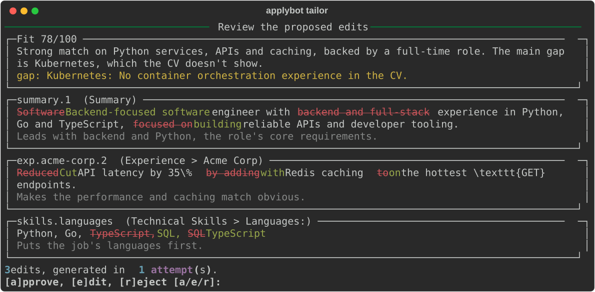

# ApplyBot

[](https://github.com/mbazaras7/ApplyBot/actions/workflows/ci.yml)

**An AI agent that tailors a LaTeX CV to a job posting, without inventing experience, and with a human approving every change.**

> **Status:** v1 (MVP), working end to end and actively developed. See the [roadmap](#roadmap).



---

## What it does

- **Reads a job posting** from a URL, PDF or pasted text and pulls out its requirements.
- **Searches your CV for evidence** of each requirement, then scores how well you fit and lists the gaps.
- **Proposes targeted edits** to your bullets, summary and skills, rewording what you've done in the job's language.
- **Checks every edit automatically**: no invented skills, no changed numbers, no broken LaTeX.
- **Puts you in control:** you approve, edit or reject the changes before anything is compiled.
- **Produces** the tailored PDF and a report of every change and why it was made.

**It never invents experience.** ApplyBot can reword, reorder and emphasise what your CV already says, but it can't add skills, employers, numbers or achievements that aren't there.

---

## Tech stack

**Python** · **LangGraph** (agent workflow with human-in-the-loop) · **Anthropic API** (LLM structured output, tool use) · **Pydantic** · **fastembed** (local semantic search) · **Typer + Rich** (CLI) · **Tectonic** (LaTeX) · **Docker** · **GitHub Actions** · **pytest**, **mypy** (strict), **ruff**

---

## How it works

1. **Parse** the LaTeX CV into addressable blocks. The preamble and structure are frozen.
2. **Analyse** the job: an agent loop searches the CV for evidence of each requirement and scores the fit.
3. **Generate** edits keyed by block ID. The model never writes raw LaTeX.
4. **Validate** every edit with deterministic checks, retrying with the errors if any fail.
5. **Review:** the workflow pauses until you approve, edit or reject. Only then does it compile the PDF and write the report.

**→ Full architecture, design decisions and current limitations: [docs/ARCHITECTURE.md](docs/ARCHITECTURE.md)**

---

## Quick start

```bash
uv sync
cp .env.example .env          # then set ANTHROPIC_API_KEY and ANTHROPIC_MODEL
uv run applybot tailor path/to/main.tex --job-file job.pdf
```

The job can also be a URL (`--job-url`) or pasted text (`--job-text`). The PDF step needs [Tectonic](https://tectonic-typesetting.github.io) installed.

**Or with Docker** (Tectonic and everything else included):

```bash
docker build --target app -t applybot .
docker run -it --rm --env-file .env -v "${PWD}:/work" applybot tailor main.tex --job-file job.pdf
```

---

## Roadmap

v1 is a complete command-line tool. **v2 turns it into a local desktop app**: everything runs on your machine, with no accounts.

- [ ] **Run history:** every tailored CV, its PDF and its report stored in a local database
- [ ] **Desktop app:** upload your CV, add extra true facts (projects, skills, courses not on the CV), and adjust the tailoring with your own instructions
- [ ] **Interactive review:** fit score, strengths and gaps; edit each section with a live PDF preview; approve to produce the tailored CV
- [ ] **History viewer:** browse past applications with their tailored CV and report side by side
- [ ] **Installer:** one download, with no Python or LaTeX setup needed

Later: full LaTeX editing in the app, automatic repair when a CV fails to compile, and more tailoring options (coursework from a transcript, restructured skills sections).

---

## Development

```bash
uv run ruff check . && uv run mypy && uv run pytest
```

Tests run without network or API calls (fake LLM, reviewer and embedder). See [docs/ARCHITECTURE.md](docs/ARCHITECTURE.md#testing-and-ci) for testing and CI details.
