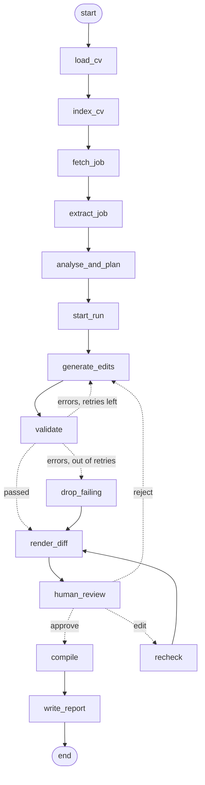

# ApplyBot: Architecture and Design

This document explains how ApplyBot works, why it's built the way it is, and where v1 falls short. For an overview and quick start, see the [README](../README.md).

---

## How a run flows

The workflow is a [LangGraph](https://langchain-ai.github.io/langgraph/) state graph. Solid arrows always run; dotted arrows are chosen by a routing function that reads the state.



| Step | What it does |
|---|---|
| `load_cv` | Parses `main.tex` into a frozen preamble, raw segments and addressable **blocks** (`summary.1`, `exp.<employer>.<n>`, `skills.<label>`), plus each subheading's arguments |
| `index_cv` | Embeds every block and subheading with a local model for semantic search |
| `fetch_job`, `extract_job` | Gets the posting's text (URL, PDF, HTML, text or stdin), then extracts structured requirements with LLM structured output |
| `analyse_and_plan` | A tool-use loop: the model calls `search_cv` per requirement, then classifies each as strength / rewrite target / gap and scores the overall fit |
| `start_run` | Creates `runs/<timestamp>_<company>/`, saves the inputs, compiles the original for its page count |
| `generate_edits` | The model returns edits keyed by block ID, guided by the analysis |
| `validate` | Deterministic checks; failures are fed back for up to 2 retries, then the failing edits are dropped |
| `render_diff`, `human_review` | Builds the diff view, then pauses the graph (`interrupt`) until the reviewer answers |
| `recheck` | Re-validates edits made by hand in the editor |
| `compile`, `write_report` | Applies the edits, compiles with Tectonic, writes `report.md` |

### Code layout

```
src/applybot/
├── cli.py            Typer CLI and the interactive reviewer
├── pipeline.py       Runs the graph, handing each review pause to a reviewer
├── agent/            State, nodes, routing (LangGraph)
├── latex/            Parser, renderer, compiler
├── llm/              Provider-neutral client + Anthropic implementation
├── tools/            fetch_job, extract_job, cv_index, analyse, generate_edits, validate, report
└── review/           Diff view and the hand-editing file format
```

### What a run saves

Everything is written to `runs/<timestamp>_<company>/`:

| File | Contents |
|---|---|
| `report.md` | Fit score, findings, every change (before / after / rationale / words introduced), validation, review rounds, output |
| `tailored.tex`, `tailored.pdf` | The tailored CV |
| `original.tex`, `original.pdf` | The CV, unchanged, for comparison |
| `job.json`, `analysis.json` | The extracted job and the requirement-by-requirement analysis |
| `edits.json`, `validation.json`, `review.json` | The approved edits, validation results and review history |

---

## Design decisions

- **Edits are keyed by block ID, never whole LaTeX.** The model supplies text for named blocks, and the renderer puts it into an otherwise byte-identical file. It never outputs the preamble, macros or braces, so it can't break them. A unit test guarantees `render(parse(tex)) == tex` byte for byte.
- **A brace-matching scanner, not regex.** Nested `\textbf{}` / `\href{}{}` and escapes like `\%` can't be parsed reliably with regular expressions, because balanced braces need a counter.
- **Allowed block IDs are a schema enum.** Strict tool use can only return real, editable IDs. The edit step still checks them, as defence in depth.
- **Validators are plain code, not another LLM.** They're deterministic, unit-testable (including adversarial cases like an invented "Kubernetes"), free, and give exact error messages the retry can act on. Judgement about whether an edit is *good* is left to the human review.
- **The human review is enforced by the graph.** The only path to `compile` goes through `human_review`, so no PDF is produced without approval.
- **Search before editing.** A tool-use loop finds evidence per requirement first, so edits target real matches and gaps are reported honestly. It's capped at 6 rounds by code: further tool calls are refused, not run.
- **Local embeddings.** No second API key, no per-call cost, and the CV isn't sent anywhere for search. About 25 chunks need no vector database: a matrix product is enough.
- **Subheadings are indexed too.** Degrees, dates, job titles and project tech stacks live in heading arguments, not bullets. Without them, a "CS degree required" would look like a gap.
- **Provider-neutral LLM interface.** The code depends on an `LLMClient` protocol (`structured`, `tool_loop`). The Anthropic implementation reads the model and key from `.env`; tests use fakes.
- **A slim, offline Docker image.** A multi-stage build keeps build tools (uv, its download cache) out of the final image, and the TeX packages and embedding model are downloaded at build time, so a run needs no network except the Anthropic API.

---

## Testing and CI

- **No network in tests.** A scripted fake LLM, a fake reviewer and a fake embedder drive every path, including retries, rejections, hand edits and the tool-use loop, with no API calls or downloads.
- **Adversarial cases.** Tests feed the validators edits that invent skills, change metrics, break braces or smuggle in LaTeX structure.
- **CI (GitHub Actions)** runs ruff, formatting, strict mypy and pytest on Python 3.11 and 3.14 for every push. Pull requests into `master` also build the Docker image and run the compile tests inside it.

```bash
uv run ruff check .
uv run ruff format --check .
uv run mypy
uv run pytest
```

---

## Current limitations (v1)

- **No automatic repair.** If the tailored CV fails to compile, the run reports the LaTeX error but doesn't revert the offending edit and retry.
- **The fit score is an LLM judgement,** not a deterministic measure. It can vary between runs, and no warning threshold is set yet.
- **Validators can't catch every embellishment.** They catch invented skills, changed numbers and broken LaTeX, but not wording that overstates experience ("fast-paced team", "worked directly with clients"). The report's "words introduced" list and the review step are the safeguard.
- **Word matching is heuristic.** The skill check, no-op warning and "words introduced" use simple word roots, so irregular forms (`built` / `build`) don't match, and very short words are ignored, so adding "end-to-end" counts as adding nothing.
- **Only the "Jake's Resume" LaTeX template** is parsed. Education, headings and contact details are never edited; the summary uses the same ±20% length limit as bullets.
- **Some job pages can't be fetched:** JavaScript-rendered or bot-protected boards (e.g. LinkedIn) return no readable text. Save the page as `.html` or paste the text instead.
- **A paused run lives in memory.** Closing the terminal during review loses that run.
- **The Docker image is ~935 MB**, mostly the ML runtime (onnxruntime, numpy) and the baked model and TeX packages. Going smaller would mean dropping the offline caches or the local embeddings.
- **Docker needs memory.** On a machine with 4 GB RAM, Docker Desktop's VM (~2 GB) runs ApplyBot slowly and can crash during builds; running with `uv` directly is much faster there.
- **In Docker on Linux**, files written to the mounted folder belong to the container's user.
